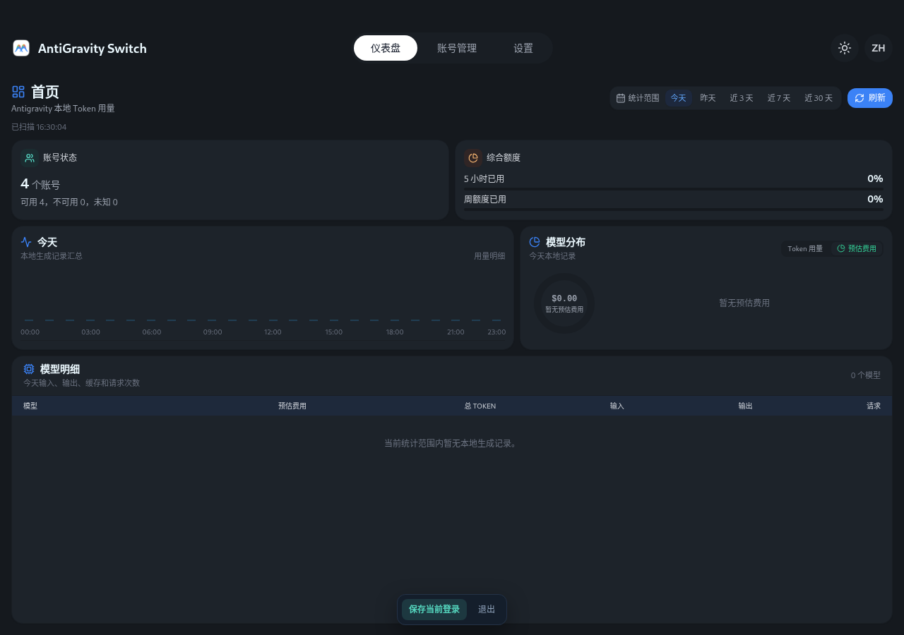
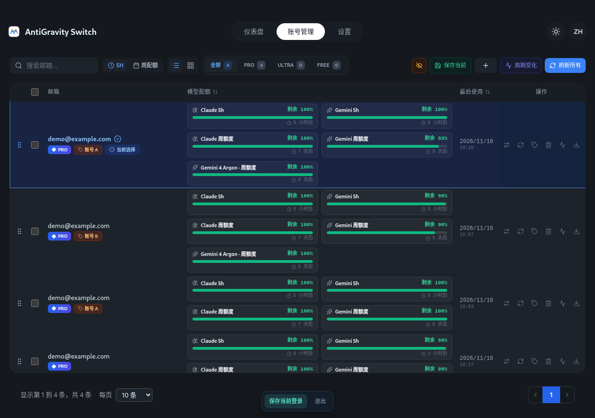
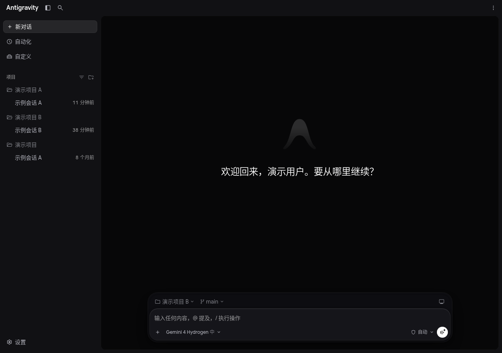

# agy-accounts

**Antigravity 多账号切换面板** · 只换身份，不换数据。

为 [AFSlayer/antigravity-server](https://github.com/AFSlayer/antigravity-server)（`agy-server`）补一个独立的账号控制面板：保存多份 Google 登录快照，在同一个网页入口里一键切换，而会话、项目、产物全部保留。

> 本项目不是 `agy-server` 的替代品，也不修改它。`agy-server` 负责网页界面与鉴权，本面板只管理 `language_server` 使用的 OAuth 令牌文件。

<div align="center">
  
  
</div>

> 界面基于 [anglee0323/agy-switch](https://github.com/anglee0323/agy-switch) 前端，已移除旧的轻量面板。

<div align="center">
  
</div>

---

## 目录

- [它解决什么问题](#它解决什么问题)
- [核心原理](#核心原理)
- [功能](#功能)
- [系统架构](#系统架构)
- [快速开始](#快速开始)
- [配置](#配置)
- [命令行](#命令行)
- [HTTP 接口](#http-接口)
- [安全设计](#安全设计)
- [故障排查](#故障排查)
- [汉化说明](#汉化说明)
- [验收与测试](#验收与测试)
- [风险与合规](#风险与合规)
- [许可](#许可)

---

## 它解决什么问题

Antigravity 没有官方的多账号切换能力。换账号通常意味着退出登录、重新走 Google 授权。

`agy-server` 提供了网页版，但没有账号管理。本项目以它作为使用界面，补上一个只做三件事的面板：

1. 展示已保存的账号；
2. 把当前登录保存成命名快照；
3. 一键切换到另一个快照。

**对话历史、项目配置、智能体产物属于业务数据，切换账号时完全不动。**

## 核心原理

Antigravity 在机器上的状态分三层：

| 层 | 内容 | 位置（默认） |
|---|---|---|
| 业务数据 | 会话、项目、产物 | `~/.gemini/` 下由 `language_server` 管理的目录 |
| 身份凭证 | Google OAuth 令牌 | `~/.gemini/jetski-standalone-oauth-token` |
| 运行时 | `language_server` 进程 | 由 `agy-server.service` 托管 |

`language_server` 启动时读取一次令牌，之后常驻内存。因此切换账号只需要：

1. 停止 `agy-server`（会同时停掉 `language_server`）；
2. 原子替换令牌文件；
3. 启动服务并探测网页是否恢复。

业务数据目录不参与任何一步。

> 三种形态的令牌互不相通：独立服务器模式、CLI、桌面应用各用各的令牌。本项目只处理 **独立服务器模式**，也就是 `agy-server` 背后 `language_server --standalone` 使用的那一份。

## 功能

- 共享密码登录，PBKDF2 哈希存储，常量时间比较；设置页可直接修改密码
- 原版风格的仪表盘、账号列表 / 卡片视图、设置页
- 账号列表：邮箱、套餐、当前标记、备注、最后使用时间、拖拽排序
- 当前账号判定：令牌字节一致，或 `refresh_token` 相同（应对 access_token 轮换）
- 每个已保存账号的套餐（Free / Pro / Ultra / Standard）与额度
- 分组额度：Claude 5h、Gemini 5h、Claude 周额度、Gemini 周额度，以及账号可用的 Gemini 4 Argon / Carbon 等独立额度
- 列表视图 2×2 汇总条，卡片视图单列；剩余百分比与重置倒计时
- 账号页工具栏「保存当前」按钮，直接保存当前登录快照
- 隐私模式：一键把邮箱与备注打码为 `***@域名`，状态保存在浏览器本地
- 账号状态与综合额度汇总卡片
- 本地 Token 用量监控：今日 / 昨日 / 3 / 7 / 30 天、24 小时趋势、按模型统计
- 首页 1–3 张卡片单排，4 张及以上均分两排，每排铺满；首字延迟与正文速度只读统计近 7 天最近 10 条有效回复的中位数，不发送额外模型请求，没有样本时显示「—」
- 保存当前登录为命名快照（右下角工具栏，自动识别邮箱）
- 一键切换：停止 → 替换 → 启动 → 验证登录。失败或不能确认时回滚；切换、自动恢复和更新重启共用操作锁
- 当前账号被 Google 判定不可用 / 需要验证时，自动尝试其它已保存账号（默认开启，可在设置页关闭）；连续三次读取登录状态失败时，仅尝试重启服务，不换账号
- Antigravity 更新提醒：可检查官方版本；只有更新目录可写且重启后确认目标版本时，才报告更新成功。部署使用默认只读沙箱时，请由管理员在主机上更新
- 失败自动回滚：任何一步出错都恢复原令牌并尽量拉起服务
- 重命名 / 编辑备注（只改显示名，目录 ID 不变）
- 删除快照（不触碰线上令牌与业务数据）
- 健康检查 `/healthz`、状态查询 `/api/status`
- 切换成功后可由配置决定跳转 Antigravity
- 运行时仅依赖 Python 3.9+ 标准库；前端是已构建的静态文件
- 登录限速、CSRF 校验、跨站 Origin 拒绝、会话 Cookie 加固
- Antigravity 网页汉化：8766 注入代理，`?no-i18n=1` 可关闭

> Token 用量来自服务器上的 Antigravity 会话数据库，按本机全部会话统计。费用估算已移除，个人自用不需要计费信息。

## 系统架构

```
手机 / 电脑浏览器
      │
      ├── http://127.0.0.1:8790/        agy-accounts 新版 UI
      │        │  systemctl stop/start agy-server
      │        └── 替换 ~/.gemini/jetski-standalone-oauth-token
      │
      └── http://127.0.0.1:8766/        agy-server 中文入口（Nginx 注入）
               │
               ▼
        http://127.0.0.1:8765/        agy-server 原站
               │
               ▼
        language_server --standalone
               │
               ▼
        Google CloudCode API
```

面板不参与任何请求转发，也不代理 Antigravity 的流量。

## 快速开始

### 前置条件

- Debian 11/12 x86_64，glibc ≥ 2.28
- Python 3.9+（只用标准库）
- systemd
- 已按 [antigravity-server 文档](https://github.com/AFSlayer/antigravity-server) 安装好 `agy-server`，网页可打开，并完成过一次 Google 登录
- 已确认令牌文件存在：`~/.gemini/jetski-standalone-oauth-token`

### 安装

```bash
git clone https://github.com/Danborad/agy-accounts.git
cd agy-accounts
sudo ./install.sh
```

安装脚本会：

1. 复制程序到 `/opt/agy-accounts`；
2. 在 `~/.config/agy-accounts/config.json` 生成配置（密码哈希，不存明文）；
3. 注册并启动 `agy-accounts.service`；
4. 执行环境自检。

指定端口 / 服务名 / 令牌路径：

```bash
sudo ./install.sh --port 8790 --agy-service agy-server \
  --token /root/.gemini/jetski-standalone-oauth-token \
  --app-url http://127.0.0.1:8765/
```

### 局域网访问

面板默认只监听 `127.0.0.1`。如果要在同一局域网内的手机 / 电脑直接访问：

```bash
sudo ./install.sh \
  --listen 0.0.0.0 \
  --app-url http://192.168.1.10:8765/
```

把 `192.168.1.10` 换成服务器的局域网地址。此时：

- 面板地址：`http://192.168.1.10:8790/`
- Antigravity 地址：`http://192.168.1.10:8765/`

`agy-server` 默认就监听 `0.0.0.0:8765`，一般无需改动。**请务必使用强密码，并且只在可信局域网内这样部署；HTTP 不会加密密码，跨网段或公网请改用 Tailscale 或 HTTPS 反向代理。**

> 面板的 `probe_url` 建议保持 `http://127.0.0.1:8765/`，让就绪探测走本机；`app_url` 才填局域网地址，用于切换成功后跳转。

安装完成后打开 `http://127.0.0.1:8790/`，输入安装时设置的密码。

需要 Antigravity 网页汉化时，再运行：

```bash
sudo ./install-i18n.sh
```

之后使用 `http://服务器地址:8766/` 打开 Antigravity（`8765` 原站仍然可用）。

- `/`：完整界面（账号管理、仪表盘、设置）
- 账号页工具栏提供「隐私」小眼睛与「保存当前」
- 右下角工具栏提供「保存当前登录」与「退出」

### 第一次使用

1. 在 Antigravity 页面登录账号 A；
2. 回到面板，在「保存当前登录」里起名保存；
3. 在 Antigravity 页面退出并登录账号 B；
4. 再保存一次；
5. 之后在面板点「切换」，等待自动跳转即可。

### 手动运行（调试）

```bash
export AGY_ACCOUNTS_PASSWORD='至少八位的临时密码'
python3 agy_accounts.py init
python3 agy_accounts.py serve
```

## 配置

默认路径：`~/.config/agy-accounts/config.json`
配置根目录可用 `AGY_ACCOUNTS_HOME` 覆盖，配置文件路径可用 `AGY_ACCOUNTS_CONFIG` 覆盖。

| 键 | 默认值 | 说明 |
|---|---|---|
| `token_path` | `~/.gemini/jetski-standalone-oauth-token` | `agy-server` 的 OAuth 令牌文件 |
| `accounts_dir` | `~/.local/share/agy-accounts/accounts` | 快照根目录（等同凭据库） |
| `service_name` | `agy-server` | 受控 systemd 单元名，用于启停和识别所属语言服务器进程 |
| `stop_command` | `[]` | 留空则用 `systemctl stop <service_name>` |
| `start_command` | `[]` | 留空则用 `systemctl start <service_name>` |
| `status_command` | `[]` | 留空则用 `systemctl is-active --quiet <service_name>` |
| `probe_url` | `http://127.0.0.1:8765/` | 启动后探测地址；空字符串表示跳过 |
| `app_url` | `http://127.0.0.1:8765/` | 切换成功后跳转的 Antigravity 地址 |
| `listen_host` | `127.0.0.1` | 面板监听地址，默认仅回环 |
| `listen_port` | `8790` | 面板端口 |
| `password_hash` | `""` | `pbkdf2_sha256$...`，推荐 |
| `password` | `""` | 明文密码，仅兼容用；两者都没有时拒绝启动 |
| `session_ttl` | `86400` | 会话有效期（秒） |
| `cookie_secure` | `false` | 走 HTTPS 反代时设为 `true` |
| `probe_timeout` | `30` | 等待服务就绪的最长秒数 |
| `command_timeout` | `30` | 单条启停命令超时 |
| `language_server_path` | `/opt/agy-server/language_server` | 用于额度查询和检查面板是否有权限下载更新；应与 `agy-server` 的实际路径一致 |
| `quota_ttl` | `300` | 额度缓存秒数 |
| `quota_timeout` | `12` | 额度接口单次请求超时秒数 |
| `stop_timeout` | `20` | 等待进程退出的最长秒数 |
| `auto_failover` | `true` | 当前账号被判定不可用时自动切换，设置页可开关 |
| `login_max_failures` | `5` | 登录失败次数上限（按 IP） |
| `login_window` | `300` | 失败计数窗口（秒） |
| `log_level` | `INFO` | 日志级别 |

环境变量覆盖：

| 变量 | 对应配置 |
|---|---|
| `AGY_ACCOUNTS_TOKEN` | `token_path` |
| `AGY_ACCOUNTS_DIR` | `accounts_dir` |
| `AGY_ACCOUNTS_SERVICE` | `service_name` |
| `AGY_ACCOUNTS_PROBE_URL` | `probe_url` |
| `AGY_ACCOUNTS_APP_URL` | `app_url` |
| `AGY_ACCOUNTS_HOST` / `AGY_ACCOUNTS_PORT` | 监听地址 / 端口 |
| `AGY_ACCOUNTS_PASSWORD` | `password`（优先于文件） |
| `AGY_ACCOUNTS_HOME` | 配置根目录 |
| `AGY_ACCOUNTS_CONFIG` | 配置文件完整路径 |

生成密码哈希：

```bash
python3 agy_accounts.py hash-password
```

### 以低权限用户运行

面板需要控制 `agy-server` 的启停。默认以 `root` 运行最简单，但仅建议在受控内网使用。

如果要以专用用户运行，需要：

1. `install.sh --user agyaccounts`；
2. 给该用户仅授权三条命令，见 `deploy/agy-accounts.sudoers.example`；
3. 在配置里把三条命令改成 `sudo -n /usr/bin/systemctl ...`；
4. 确保该用户对令牌文件与快照目录有读写权限。

## 前端构建（仅开发时需要）

仓库已经提交构建好的 `webapp/`，目标 Debian 主机不需要安装 Node.js。

修改前端源码后：

```bash
cd webapp-src
./build.sh            # 需要 Node.js 22.12+
```

构建产物会写入 `webapp/`。源码与改动说明见 [`webapp-src/README.md`](webapp-src/README.md)。

## 命令行

```bash
python3 agy_accounts.py serve            # 启动面板（默认命令）
python3 agy_accounts.py init             # 生成默认配置
python3 agy_accounts.py hash-password    # 生成 password_hash
python3 agy_accounts.py check            # 自检环境、命令与权限
python3 agy_accounts.py --version
```

## HTTP 接口

除 `/healthz`、`/api/login` 与静态资源外，其余接口都要求登录会话。
所有 POST / DELETE 请求必须带请求头 `X-Agy-Accounts: 1`。

| 方法 | 路径 | 说明 |
|---|---|---|
| `GET` | `/` | 面板页面 |
| `GET` | `/healthz` | 健康检查，无需登录 |
| `POST` | `/api/login` | `{"password":"..."}`，成功返回会话 Cookie |
| `POST` | `/api/logout` | 清除会话 |
| `GET` | `/api/status` | 账号列表、当前标记、服务状态、切换状态 |
| `GET` | `/api/quotas` | 各账号套餐与额度；`?refresh=1` 强制刷新 |
| `GET` | `/api/usage` | 本地 Token 用量汇总；`?refresh=1` 绕过 60 秒缓存 |
| `GET/POST` | `/api/preferences` | 服务端保存首页卡片选择 |
| `GET/POST` | `/api/failover` | 查询 / 开关「账号失效自动切换」 |
| `GET` | `/api/update` | 查询当前与待应用的 Antigravity 版本 |
| `POST` | `/api/update` | `{"action":"check"}` 检查官方更新；`{"action":"apply"}` 更新并重启 |
| `POST` | `/api/accounts` | `{"name":"..."}` 保存当前登录 |
| `POST` | `/api/accounts/{id}/switch` | 切换账号 |
| `POST` | `/api/accounts/{id}/rename` | `{"name":"..."}` 改显示名 |
| `POST` | `/api/accounts/{id}/delete` | 删除快照 |
| `DELETE` | `/api/accounts/{id}` | 删除快照（等价） |

错误统一返回 `{"ok": false, "error": "..."}`；切换失败时附加 `rolled_back`。
接口不会返回任何令牌内容。

## 安全设计

- 默认只监听 `127.0.0.1`；只有显式设置 `--listen 0.0.0.0` 才对局域网开放
- 未配置密码时拒绝启动
- 密码使用 PBKDF2-SHA256（20 万次）哈希，比较使用 `hmac.compare_digest`
- 会话 Cookie：`HttpOnly` + `SameSite=Strict`；HTTPS 场景可加 `Secure`
- 所有写操作校验自定义请求头与 `Origin`，无 CORS 响应头
- 登录失败按 IP 限速，默认 5 次 / 5 分钟
- 令牌与快照权限 `0600`，目录 `0700`
- 令牌写入采用临时文件 + `os.replace` 原子替换
- 日志只记录令牌长度与摘要前缀，绝不输出内容
- 快照目录等同凭据库：`.gitignore` 已排除，不要提交或打包分享

> 不要将面板密码分享给多人。建议只在自己控制的机器与私有网络内使用；如需远程访问，放在 Tailscale 等私有网络之后，或再加一层带密码的反向代理。

## 额度显示

面板会为每个**已保存的快照**查询 Antigravity 的 CloudCode 配额接口，显示：

- 套餐等级：Free / Pro / Ultra / Standard
- Claude / GPT 与 Gemini 的 5 小时、每周剩余比例
- 重置时间，以及“当前不适用”的桶

额度查询使用与 Antigravity 语言服务器一致的 `aidev_client` User-Agent，并优先使用 `daily-cloudcode-pa.googleapis.com`：`fetchAvailableModels` 取逐模型额度，`retrieveUserQuotaSummary` 取 5 小时 / 每周分组，`loadCodeAssist` 取套餐。面板把数据归并为 Claude / Gemini × 5h / 周额度 四个汇总条；接口没有返回的分组会显示「暂无数据」，不会伪造百分比。额度请求使用快照自己的 `access_token`；快照过期时会用 `refresh_token` 刷新并写回快照。若该账号正是当前登录，刷新后的令牌也会同步到线上令牌文件（与切换事务互斥，避免交叉写入）。结果缓存 `quota_ttl` 秒（默认 5 分钟），页面上的“刷新”会强制重查。

说明：

- 只查询已保存的账号；未保存的当前登录不会出现在额度列表里。
- 需要服务器能访问 `daily-cloudcode-pa.googleapis.com` 与 `oauth2.googleapis.com`。
- 刷新使用 Antigravity 安装型 OAuth 客户端的公开凭据（Google 说明安装型应用密钥不属于机密），优先从 `language_server` 提取，并内置一份兼容回退。
- 查询失败不会影响账号保存与切换；卡片会显示“额度暂不可用”或上一次缓存。

## Token 用量

仪表盘扫描 `~/.gemini/antigravity*/conversations/*.db`，解析 Antigravity 的生成记录，汇总：

- 今日 / 昨日 / 近 3 / 7 / 30 天 Token
- 24 小时趋势与按模型分布
- 输入、输出、缓存 Token 与请求次数

数据是**本机全部会话**的合计，不按登录账号拆分；只读数据库，不会修改会话。结果缓存 60 秒，页面「刷新」会强制重扫。费用估算已从界面移除，不参与统计。

## 故障排查

| 现象 | 处理 |
|---|---|
| 面板起不来，日志提示未配置密码 | `python3 agy_accounts.py hash-password` 后写入 `password_hash` |
| `check` 提示令牌目录不存在 | 先完成一次 `agy-server` 网页登录；或修正 `token_path` |
| 切换报「命令执行失败」 | 面板用户无权控制服务；用 root 或配置 sudoers |
| 切换报「服务在 30s 内未就绪」 | 看 `journalctl -u agy-server -n 100`；确认 `probe_url` 正确；以错误消息中的回滚结果为准 |
| 切换提示「回滚未完成」 | 不要继续切换。检查服务和令牌目录权限；如果提示原凭据备份路径，管理员可在停止服务后用该文件恢复原令牌（权限 `0600`），再启动服务。确认恢复后删除备份，不要分享备份内容 |
| 切换时提示 409 | 已有切换在进行，等待完成 |
| 页面一直停留在登录 | 检查浏览器是否禁用 Cookie；确认访问地址与面板一致 |
| 切换后自动跳转失败 | 配置 `app_url` 为实际可访问的 Antigravity 地址 |
| 手机访问不到 | 面板默认仅回环；用 Tailscale 或反代，不要直接监听 `0.0.0.0` 暴露公网 |

查看日志：

```bash
journalctl -u agy-accounts -f
```

## 汉化说明

汉化由 `install-i18n.sh` 安装的一层 Nginx 代理完成，不修改 `agy-server` 二进制，因此上游升级不会被覆盖。

- 中文入口：`http://服务器地址:8766/`
- 原站入口：`http://服务器地址:8765/`
- 临时关闭汉化：网址后加 `?no-i18n=1`
- 恢复汉化：网址后加 `?i18n=1`
- 脚本：`i18n/agy-i18n.js`

当前汉化引擎来自
[antigravity-cn-community/Antigravity-Chinese-Localization](https://github.com/antigravity-cn-community/Antigravity-Chinese-Localization)
的 Web UI DOM 注入部分（MIT License，上游 v2.32.2.1）。该项目原本通过替换 Electron `app.asar` 汉化桌面客户端；
本项目只取出其中自包含的 `DOM_TRANSLATOR_INJECTION`，由 Nginx 注入网页，不执行 `app.asar` 替换，也不修改官方安装目录。

- 约 5000 条词库与动态正则，覆盖侧栏、规划模式、设置、权限沙盒、插件市场、Remote SSH 等
- 汉化词典内置于 `i18n/agy-i18n.js`；`i18n/zh-CN.json` 是旧版外置词库，保留用于兼容
- 保护输入框、代码块、Monaco 编辑器、用户对话正文、项目名与模型名
- 上游更新后执行 `node scripts/update-i18n.mjs`，再安装脚本并重启 `agy-i18n-proxy` 即可同步

安装脚本会安装 `nginx-light`（如果尚未安装），并禁用系统默认 nginx 服务，改用独立单元 `agy-i18n-proxy.service` 监听 8766，不影响 NAS 自带的 443 Nginx。注入脚本已启用 gzip。

## 验收与测试

自动测试不依赖真实 `agy-server`，用假 `systemctl` 模拟启停与失败回滚：

```bash
python3 -m unittest discover -s tests -v
```

首页布局和 Web 桥接的浏览器测试（Node.js 22）：

```bash
cd webapp-src
npm ci
npm run build
npx playwright install chromium --only-shell
npx playwright test
```

当前覆盖：

- 未登录访问账号接口被拒绝
- 错误密码不泄露账号信息
- 保存快照、拒绝重复保存
- 切换账号、已当前账号不重启
- 令牌轮换回写：线上令牌刷新后自动同步到对应快照
- 额度查询：按账号调用 CloudCode API，缓存 5 分钟，支持手动强制刷新
- 启动失败自动回滚
- 停止失败不触碰令牌
- 重命名、删除、路径穿越拒绝
- 登录限速、邮箱解析、中文名称规范化

手工验收清单见 [docs/验收清单.md](docs/验收清单.md)，部署细节见 [docs/部署指南.md](docs/部署指南.md)。

## 风险与合规

- 多账号轮换以规避配额限制是这套方案的主要风险，也最容易触发平台风控；请自行评估并遵守服务条款。
- 上游更新可能改变令牌路径、服务行为或页面结构，升级后请重新跑 `check` 与验收清单。
- 不要把面板密码分享给多人，那会构成账号共享。
- 本项目不做账号共享与对外售卖，不实现 Google 授权流程，不默认做账号级数据隔离。
- 不承诺切换过程零中断：切换期间 `agy-server` 会短暂停止。

## 许可

本项目采用 **CC BY-NC-SA 4.0**（署名—非商业性使用—相同方式共享 4.0 国际）。

- 允许个人使用、修改与非商业分享
- 必须署名、保留许可证声明，并说明修改内容
- 修改后的衍生作品必须使用相同许可证
- **不得用于商业目的**
- 完整法律文本见 [LICENSE](LICENSE)，版权与署名信息见 [NOTICE](NOTICE)

> 说明：Creative Commons 官方并不建议将 CC 许可用于软件，因为其缺少专利授权与源代码分发条款。本项目按项目所有者的要求采用该许可；如需商业使用，请另行取得授权。

## 致谢

- [AFSlayer/antigravity-server](https://github.com/AFSlayer/antigravity-server)：提供 Antigravity 网页入口与鉴权。
- [router-for-me/CLIProxyAPI](https://github.com/router-for-me/CLIProxyAPI)：Antigravity 额度端点与逐模型探测逻辑的参考。
- [anglee0323/agy-switch](https://github.com/anglee0323/agy-switch)：`webapp-src/` 与 `webapp/` 的前端来源，同一 CC BY-NC-SA 4.0 许可；本项目补充了 Tauri → HTTP 桥接并做了少量构建调整，详见 `NOTICE` 与 `webapp-src/README.md`。
- [antigravity-cn-community/Antigravity-Chinese-Localization](https://github.com/antigravity-cn-community/Antigravity-Chinese-Localization)：`i18n/agy-i18n.js` 的 Web UI DOM 翻译引擎与词库来源，MIT 许可；本项目只使用其浏览器注入部分，不执行 `app.asar` 替换。

与 Google、AFSlayer/antigravity-server 及上述社区项目均无隶属关系，仅为个人自托管的组合方案。
